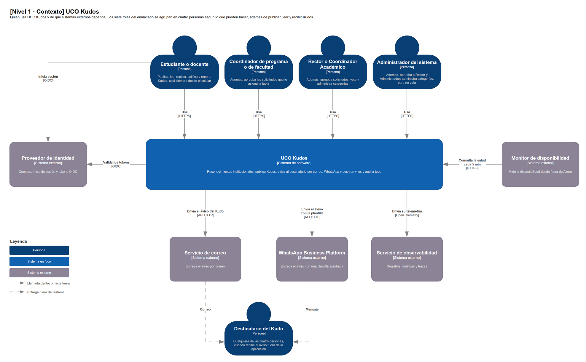
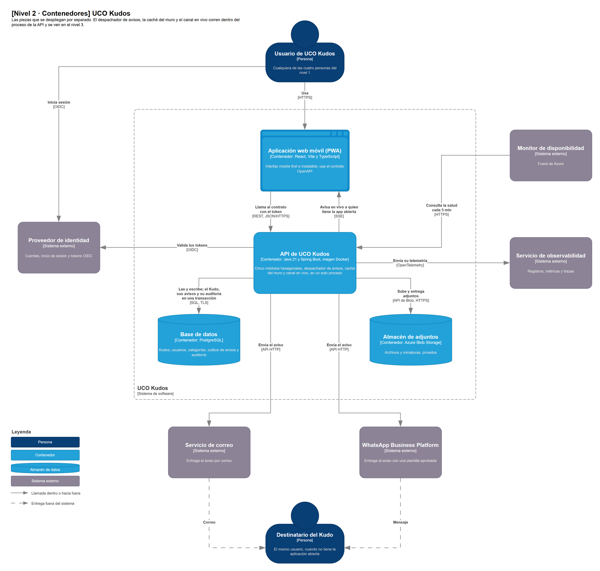
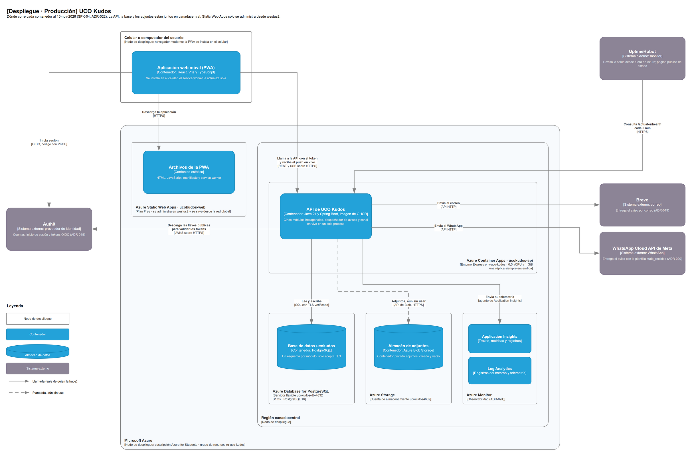
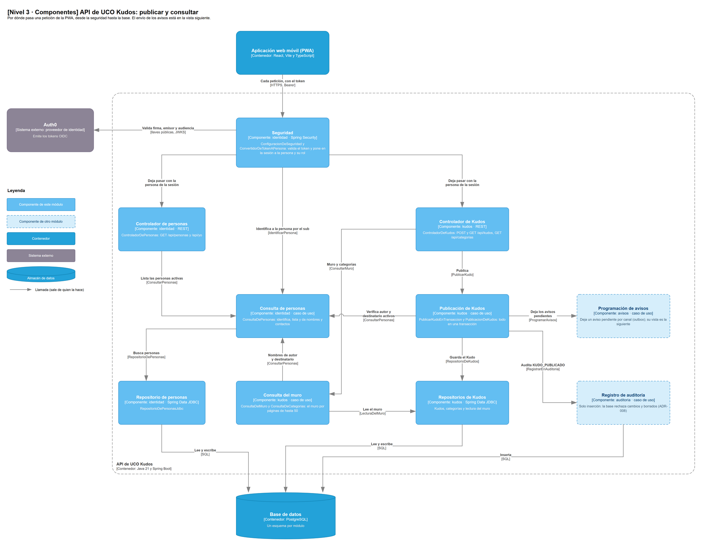
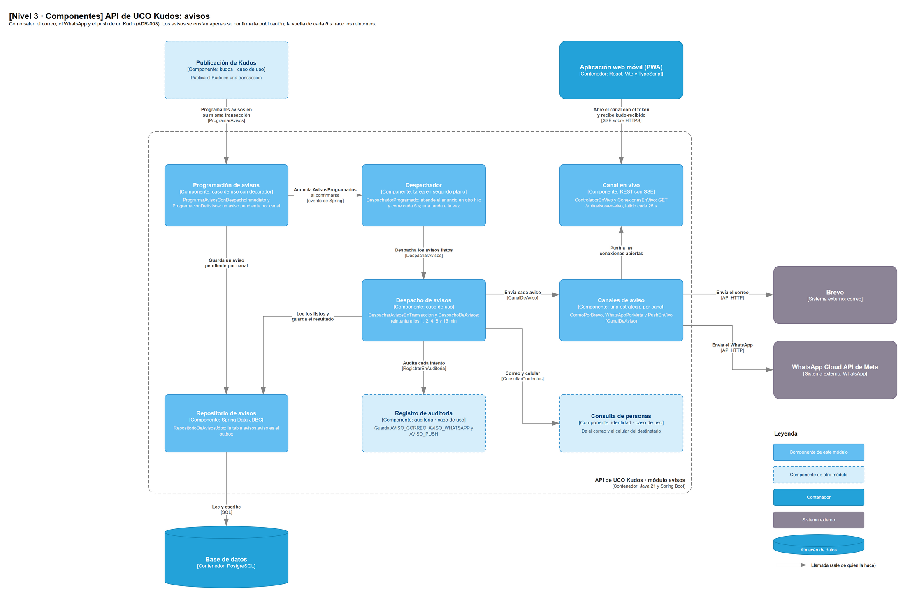
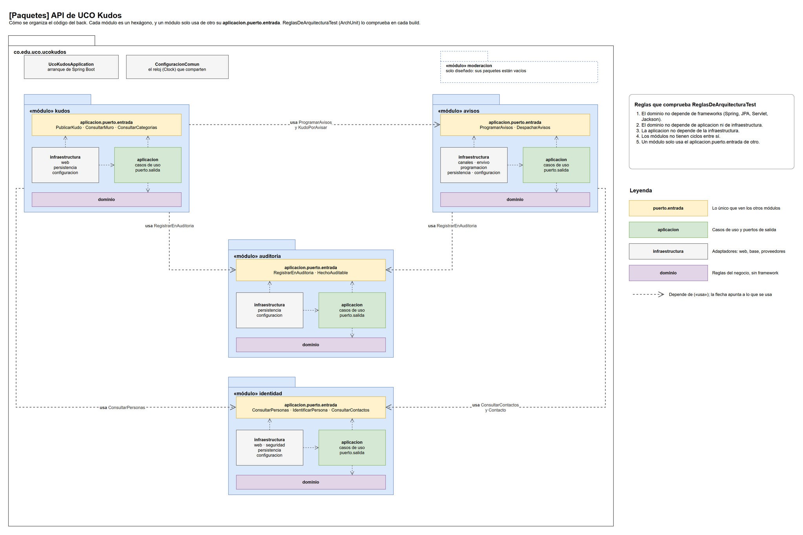

# UCO Kudos

> **Borrador:** completado con IA a partir de la documentación de `docs/`. Revísalo y borra esta nota
> cuando el documento sea tuyo.

## Plataforma institucional de reconocimientos · Proyecto integrador de Ingeniería del Software II

> **Jerónimo Montoya Londoño**

**URL pública:** [happy-bush-0fa58021e.4.azurestaticapps.net](https://happy-bush-0fa58021e.4.azurestaticapps.net) · **API:** [ucokudos-api](https://ucokudos-api.grayriver-ab7e245b.canadacentral.azurecontainerapps.io/actuator/health) · **Disponibilidad:** [página de estado](https://stats.uptimerobot.com/Kg3YSa2rj9) · **Front-End:** [uco-kudos-frontend](https://github.com/jeromontoya19/uco-kudos-frontend) · **Documentación:** [docs/](docs/README.md) · **Manual:** [puesta a punto](docs/05-manual-puesta-a-punto/MANUAL_DE_PUESTA_A_PUNTO.md) · **Evidencias:** [índice](docs/evidencias/README.md)

---
### UCO Kudos

Una persona de la comunidad académica de la Universidad Católica de Oriente le reconoce a otra un
logro con un **Kudo**, dentro de una categoría institucional. El reconocido se entera enseguida por
correo, por WhatsApp y, si tiene la aplicación abierta, con un aviso en pantalla. La usan siete roles,
y casi todos entran desde el celular.

| Driver | Qué exige | Cómo se resolvió |
|---|---|---|
| `DRV-001` Movilidad | ~90 % de los usuarios desde el celular → *mobile first* | PWA instalable, con React, Vite y TypeScript (`ADR-006`, `ADR-016`) |
| `DRV-002` Alta demanda de lectura | La mayoría de las operaciones son consultas | Muro paginado; caché en memoria de una sola instancia (`ADR-004`, `ADR-011`) |
| `DRV-003` Notificaciones multicanal | Correo, WhatsApp y push | Outbox con despachador y reintentos: Brevo, Cloud API de Meta y Server-Sent Events (`ADR-003`, `ADR-019` a `ADR-021`) |
| `DRV-004` Adjuntos | Carga de archivos con almacenamiento, seguridad, recuperación y trazabilidad | Diseñado en `ADR-009`; la construcción quedó pendiente (`D-65`) |
| `DRV-005` Seguridad | Mecanismos de seguridad justificados | Auth0 con tokens OIDC; la API valida cada token y lee el rol de su base (`ADR-007`, `ADR-018`) |
| `DRV-006` Observabilidad | Monitoreo, métricas, trazas y auditoría | Application Insights, auditoría de solo inserción y UptimeRobot (`ADR-024`, `ADR-008`, `ADR-014`) |
| `DRV-007` Automatización | DevSecOps desde la línea base | GitHub Actions con Sonar, Trivy, CD por OIDC y vuelta atrás (`ADR-023`) |

> ### ¿Qué hace que el sistema ya no sea útil?
> ### **«Que un Kudo se pierda o que su destinatario nunca se entere.»**

Esa frase (`D-01`) ordena todo lo demás. El Kudo y sus avisos pendientes se guardan en una sola
transacción. Los avisos salen en segundo plano, se reintentan, y cada uno termina en un estado final
que queda auditado.

---
# 1. Trade-off de atributos de calidad

Los cuatro actores votaron 13 atributos. Los cinco primeros son **Seguridad**, **Confiabilidad**,
**Disponibilidad**, **Cumplimiento** y **Capacidad para ser Soportado** (`D-35`). Cuando dos chocan,
gana el de mejor puesto. Algunos de los choques más importantes:

| Choque | Gana | Se sacrifica |
|---|---|---|
| Confiabilidad del Kudo contra la entrega inmediata | El Kudo se publica aunque falle un canal | El aviso puede llegar después de un reintento |
| Rendimiento de lectura contra la frescura del muro | El muro se lee de una caché | Un Kudo nuevo puede tardar unos segundos en aparecer |
| Seguridad contra la revocación inmediata | Tokens de 15 min, con el rol leído en cada petición | Hay un margen de minutos en la sesión de Auth0 |
| Escalabilidad contra tiempo y costo | El plazo y el crédito | Una sola instancia: los 800 simultáneos son meta de diseño |

Detalle: [drivers §6](docs/02-drivers-arquitectonicos/DRIVERS_ARQUITECTONICOS.md).

# 2. Preguntas de caracterización

Treinta preguntas de sí o no convierten cada atributo en una necesidad concreta, por ejemplo: «¿cada
acción la hace solo el rol que el enunciado autoriza?». Dieciséis pasaron al Top y cada una se volvió
un escenario. Detalle: [drivers §7](docs/02-drivers-arquitectonicos/DRIVERS_ARQUITECTONICOS.md).

# 3. Escenarios de calidad

Son 16 escenarios (`ESC-01` a `ESC-16`), cada uno con su fuente, estímulo, artefacto, entorno,
respuesta y medida. La [§9 de los drivers](docs/02-drivers-arquitectonicos/DRIVERS_ARQUITECTONICOS.md)
enlaza cada uno con sus ADR y su evidencia. Con evidencia en producción:

| Escenario | Medida | Resultado |
|---|---|---|
| `ESC-04` Publicar aunque falle un canal | Respuesta en ≤ 2 s; 0 Kudos perdidos | **353 ms**, sin esperar a los canales |
| `ESC-05` Correo y WhatsApp | Entregados en ≤ 1 min | Correo en **4,0 s** y WhatsApp en **4,6 s** |
| `ESC-14` Push en vivo | En ≤ 2 s | Unos **1,5 s** |
| `ESC-15` Despliegue y vuelta atrás | CD ≤ 15 min; vuelta atrás ≤ 10 min | CD en menos de 2 min; vuelta atrás en **47 s** (back) y **38 s** (front) |
| `ESC-07` Disponibilidad | 99 % | En medición con UptimeRobot |

# 4. ADR

Son 25 ADR. Los 14 de arquitectura y 9 de los 11 de tecnología ya están aceptados. Siguen propuestos
`ADR-017`, por la parte de archivos, y `ADR-025`, las copias de seguridad. Índice:
[`docs/03-arquitectura/adr/`](docs/03-arquitectura/adr/README.md). Las decisiones del autor que los
originan (`D-01` a `D-65`) están en
[`DECISIONES.md`](docs/02-drivers-arquitectonicos/DECISIONES.md).

| Decisión clave | ADR |
|---|---|
| Monolito modular con un hexágono por módulo | `ADR-001`, `ADR-002` |
| Avisos con outbox, despachador y reintentos | `ADR-003` |
| Identidad delegada en Auth0 | `ADR-007`, `ADR-018` |
| Auditoría de solo inserción | `ADR-008` |
| Java 21 y Spring Boot; React, Vite y TypeScript | `ADR-015`, `ADR-016` |
| Azure Container Apps, Static Web Apps y PostgreSQL | `ADR-017`, `ADR-022` |
| GitHub Actions, Sonar, Trivy y CD por OIDC | `ADR-023` |
| Application Insights | `ADR-024` |

# 5. C4: contexto, contenedores y despliegue







Detalle y tablas: [`C4.md`](docs/03-arquitectura/C4.md). La versión local está en
[`C4-N2-local.png`](docs/03-arquitectura/imagenes/C4-N2-local.png).

# 6. Diagrama de componentes

El nivel 3 del C4, en dos vistas: publicar un Kudo y despachar los avisos.





# 7. Diagrama de paquetes



Son cinco módulos (`kudos`, `avisos`, `identidad`, `auditoria` y `moderacion`), cada uno con
`dominio`, `aplicacion` (con sus puertos) e `infraestructura`. ArchUnit frena la CI si un módulo usa
algo de otro que no sea su puerto de entrada. Detalle y patrones de diseño:
[`DISENO_DETALLADO.md`](docs/03-arquitectura/DISENO_DETALLADO.md).

# 8. Diagramas de secuencia

En [`DISENO_DETALLADO.md`](docs/03-arquitectura/DISENO_DETALLADO.md#diagramas-de-secuencia), en
Mermaid, con los tiempos medidos en producción:
1. **Publicar un Kudo:** el flujo obligatorio, en una sola transacción.
2. **Despachar los avisos:** correo, push y WhatsApp, con reintentos.
3. **Iniciar sesión y escuchar los avisos en vivo.**

# 9. Forma de desarrollo y uso de IA

- **Primero la arquitectura, después el código.** Los drivers, las decisiones y los ADR se escribieron
  antes de construir. Las tecnologías riesgosas se probaron con spikes de tiempo limitado:
  `SPK-01` (WhatsApp) y `SPK-04` (Azure).
- **Incrementos pequeños y desplegados**, cada uno con sus pruebas: base de datos, dominio y publicar,
  seguridad, despachador de avisos, push en vivo y observabilidad.
- **Clean Code y Clean Architecture:** puertos y adaptadores, casos de uso sin framework, objetos de
  valor e inmutables, y pruebas sin infraestructura para el dominio. Los patrones usados y su
  justificación están en el [diseño detallado](docs/03-arquitectura/DISENO_DETALLADO.md#patrones-de-diseño).
- **Uso de IA:** permitido por el enunciado. Se usó un asistente de IA para proponer
  alternativas, escribir código y pruebas, y redactar documentación. Cada decisión la tomó el autor:
  quedó registrada en una ronda de `DECISIONES.md`, y los ADR solo pasaron a Aceptada con su visto
  bueno. Los documentos preparados con IA llevan una nota de borrador hasta que el autor los revisa.

# 10. Estrategia de ramas

Dos repositorios, el back (este) y el [front](https://github.com/jeromontoya19/uco-kudos-frontend),
con las mismas ramas (`ADR-013`):

```text
codigo-desarrollo ──PR──▶ codigo-testing ──PR──▶ main ──CD──▶ Azure
documentacion-desarrollo ──PR──▶ main          (no despliega)
```

- Cada PR corre la CI completa: pruebas, cobertura, Sonar y Trivy. Si algo falla, no se fusiona.
- Se fusiona siempre con «Create a merge commit» y sin borrar ramas.
- Las acciones de GitHub van fijadas por SHA.
- `main` solo cambia por PR, y cada merge despliega solo. La vuelta atrás es un workflow manual.

# 11. Evidencias

Todas las obligatorias del enunciado están en el
**[índice de evidencias](docs/evidencias/README.md)**, una por fila: CI, CD, Sonar, Trivy,
publicación, despliegue, correo, WhatsApp, push, auditoría, observabilidad y pruebas.
