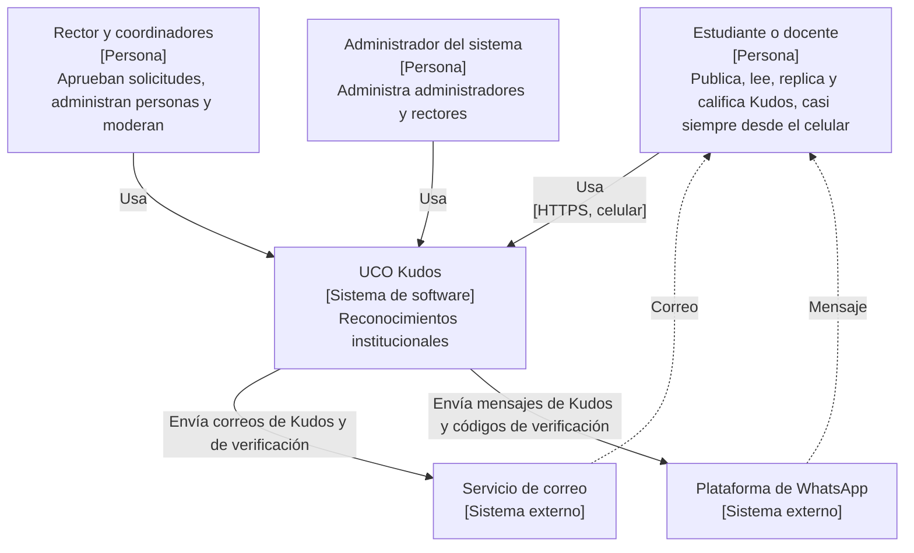
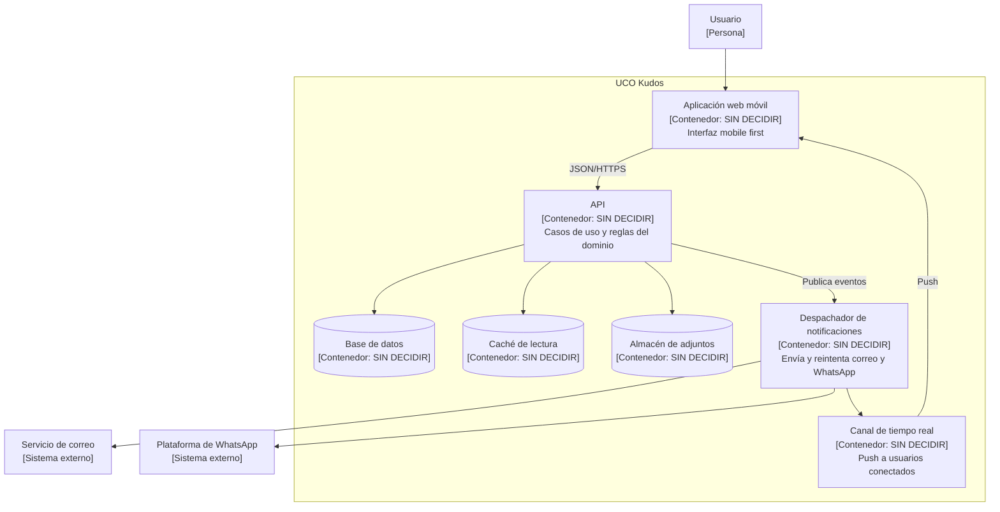

# UCO Kudos — Modelo C4

> **Plantilla:** generada con IA a partir de FlorLogic y del enunciado. Las filas de ejemplo son sugerencias: revísalas o reemplázalas, y borra esta nota cuando el documento sea tuyo.

> **v0.1 · 11-nov-2026 · Sin tecnología.** La tecnología se anota cuando su ADR queda aceptado.

## Nivel 1 · Contexto

| Elemento | C4 | Tecnología | Responsabilidad |
|---|---|---|---|
| UCO Kudos | Sistema | — | `RF-001`, … |
| Servicio de correo | Sistema externo | SIN DECIDIR | `DRV-003`; verificación del correo institucional |
| Plataforma de WhatsApp | Sistema externo | SIN DECIDIR | `DRV-003`; verificación del celular |

`[!]` La notificación push: si se resuelve con una conexión propia (WebSocket), es parte de UCO Kudos
y no aparece aquí; si se usa un servicio de push de terceros, es otro sistema externo. Lo decide su ADR.

## Nivel 2 · Contenedores

| Contenedor | C4 | Tecnología | Responsabilidad |
|---|---|---|---|
| Aplicación web móvil | Contenedor | SIN DECIDIR | `DRV-001` |
| … | | | |

## Despliegue

(Después de los ADR de despliegue: un nodo por plataforma, qué contenedor corre en cada uno y la URL pública.)

## Leyenda

Persona · Sistema en foco · Sistema externo · Contenedor · Base de datos o almacén (cilindro).
Línea continua: llamada dentro del sistema. Línea punteada: entrega fuera del sistema.
