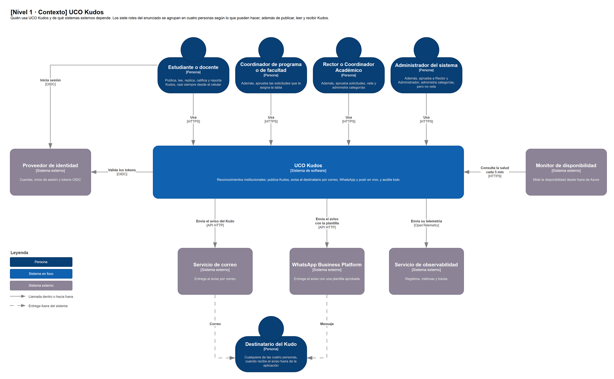
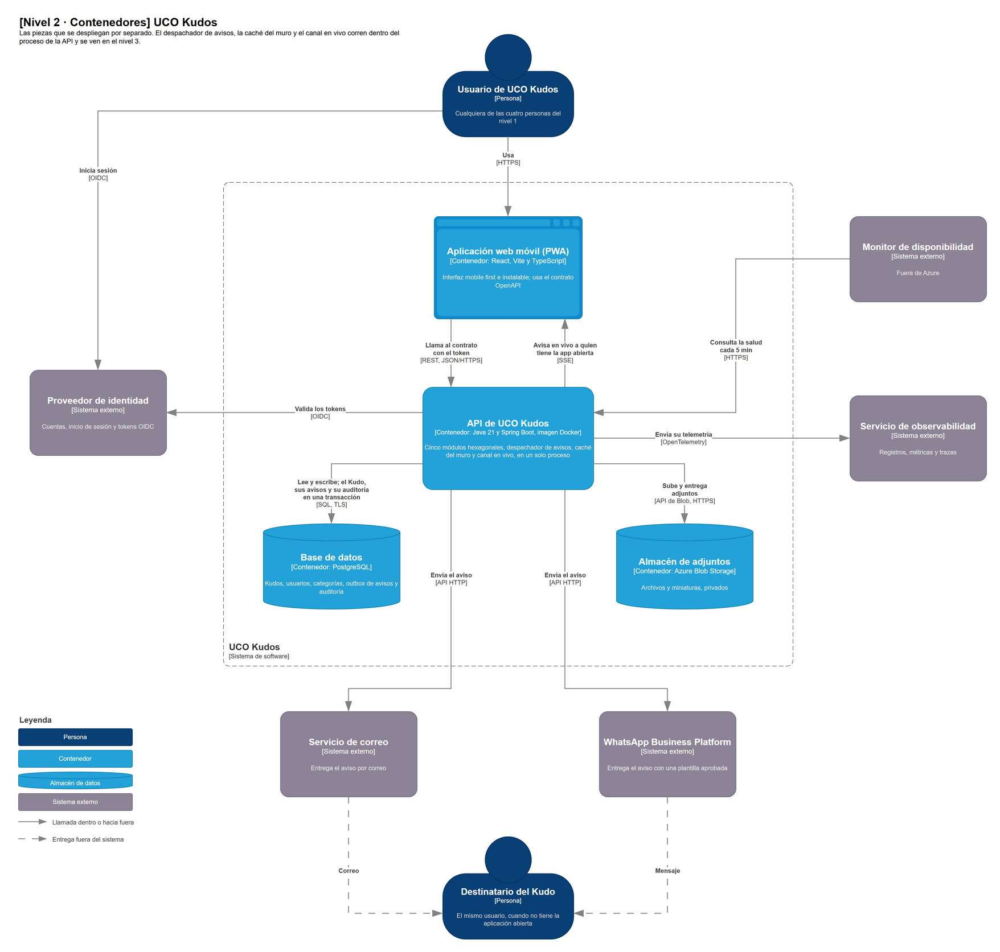
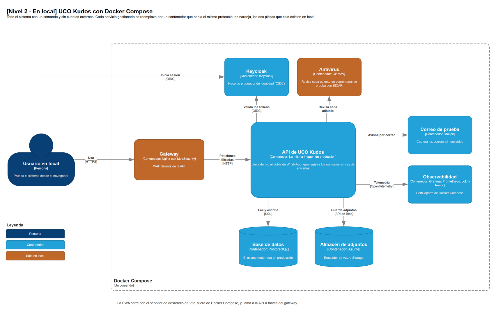

# UCO Kudos — Modelo C4

**v0.3 · 13-nov-2026 · Jerónimo Montoya Londoño**

> Nivel 1 (contexto) y nivel 2 (contenedores), con la forma que fijan los ADR aceptados y la
> tecnología de los ADR propuestos. Se apoya en
> [`ALTERNATIVA_DE_SOLUCION.md`](ALTERNATIVA_DE_SOLUCION.md) y en el [índice de ADR](adr/README.md).
> El despliegue queda adelantado como tabla y se dibuja cuando `ADR-022` quede aceptado. El nivel 3
> (componentes) se dibuja desde el código ya escrito.
>
> **Los diagramas están en draw.io:** [`imagenes/UCO-Kudos-C4.drawio`](imagenes/UCO-Kudos-C4.drawio), con una
> página por diagrama y las figuras de la librería C4 de draw.io. Los PNG de este documento se
> exportan de ese archivo: si se cambia un diagrama, se vuelve a exportar su página.

## Cómo leer cada elemento

Como en FlorLogic, cada elemento tiene tres datos:

```text
C4:              qué es en el modelo C4 (persona, sistema, sistema externo, contenedor)
TECNOLOGÍA:      la del ADR que la decide
RESPONSABILIDAD: qué hace, con el RF, CN, DRV o ADR que lo justifica
```

- **Tecnología de un ADR aceptado:** se escribe tal cual.
- **Tecnología de un ADR propuesto:** se escribe con «(propuesta)» y el ADR. El diagrama solo cambia si
  el spike de ese ADR la rechaza.
- **`[!]`:** marca un bloqueo o algo que todavía no está decidido.

---

## Nivel 1 · Contexto

UCO Kudos es una sola caja. Alrededor están las personas que lo usan y los sistemas externos de los
que depende. Los siete roles del enunciado se agrupan en cuatro personas según lo que pueden hacer.
**Todas** publican, leen y reciben Kudos; lo que las distingue es lo que hacen además de eso.



Para no recargar el diagrama, el inicio de sesión se dibuja solo para «Estudiante o docente»; las
otras tres personas inician sesión igual. Los avisos llegan al **«Destinatario del Kudo»**, que puede
ser cualquiera de las cuatro personas: se dibuja aparte, abajo, para que las entregas por correo y
WhatsApp no crucen el diagrama.

### Elementos

| Elemento | C4 | Tecnología | Responsabilidad |
|---|---|---|---|
| Estudiante o docente | Persona | Navegador del celular o del computador (`ADR-006`) | Publica Kudos y los lee en el muro (`RF-001`, `RF-005`); replica, califica y reporta (`RF-008`, `RF-009`). Recibe los avisos (`RF-002`). ~90 % entra desde el celular (`DRV-001`) |
| Coordinador de programa o de facultad | Persona | Igual | Además, aprueba las solicitudes de registro que le asigna la tabla de aprobaciones (`RF-007`, `CN-09`). El de programa administra los estudiantes y docentes de su programa; el de facultad, los coordinadores de programa de su facultad |
| Rector o Coordinador Académico | Persona | Igual | Además, aprueban solicitudes (`RF-007`, `CN-09`), son los únicos que vetan (`RF-009`) y administran categorías (`RF-006`). El Coordinador Académico administra a los coordinadores de facultad, y el Rector, a los coordinadores académicos |
| Administrador del sistema | Persona | Igual | Además, aprueba las solicitudes de Rector y de Administrador (`RF-007`, `CN-09`), administra categorías (`RF-006`) y administra a otros administradores y rectores. Está arriba en la jerarquía y aun así **no puede vetar** (`DRV-008`) |
| Destinatario del Kudo | Persona | Correo y WhatsApp en el celular | Cualquiera de las cuatro personas, cuando recibe el aviso fuera de la aplicación (`RF-002`, `DRV-003`). Es la misma gente de arriba, dibujada aparte |
| UCO Kudos | Sistema en foco | Monolito modular con Clean Architecture (`ADR-001`) | Publicar un Kudo y dejarlo guardado aunque fallen los avisos, avisar por tres canales, auditar todo y servir el muro (`RF-001` a `RF-009`; `DRV-001` a `DRV-009`) |
| Proveedor de identidad | Sistema externo | Auth0 o Zitadel Cloud (propuesta, `ADR-018`); el patrón, en `ADR-007` | Cuentas, inicio de sesión y emisión de tokens OIDC. UCO Kudos no guarda contraseñas: solo valida los tokens (`DRV-005`, `ESC-02`) |
| Servicio de correo | Sistema externo | Resend o Brevo por API HTTP (propuesta, `ADR-019`) | Entregar el aviso por correo (`RF-002`, `DRV-003`). Va por HTTP porque Azure bloquea el puerto 25 (`CN-19`) |
| WhatsApp Business Platform | Sistema externo | Cloud API de Meta (propuesta, `ADR-020`) | Entregar el aviso por WhatsApp con una plantilla aprobada (`RF-002`, `CN-14`, `CN-18`) |
| Servicio de observabilidad | Sistema externo | Application Insights, de Azure Monitor (propuesta, `ADR-024`) | Guardar y mostrar los registros, las métricas por canal y las trazas de cada publicación (`DRV-006`, `ESC-12`) |
| Monitor de disponibilidad | Sistema externo | UptimeRobot (propuesta, `ADR-022`); la meta, en `ADR-014` | Medir la disponibilidad desde fuera de Azure y avisar si la API se cae, para que siga midiendo aunque falle la suscripción (`ESC-07`, `D-43`) |

### Relaciones

| Desde | Hacia | Qué | Cómo |
|---|---|---|---|
| Las cuatro personas | UCO Kudos | Usan la aplicación | HTTPS, desde el navegador; el celular va primero (`DRV-001`) |
| Las cuatro personas | Proveedor de identidad | Inician sesión; UCO Kudos las redirige allí | OIDC, en el navegador (`ADR-007`) |
| UCO Kudos | Proveedor de identidad | Valida cada token con las llaves públicas del IdP, sin consultarlo en cada petición | OIDC (`ADR-007`) |
| UCO Kudos | Servicio de correo | Envía el aviso del Kudo | API HTTP del proveedor (`ADR-019`) |
| UCO Kudos | WhatsApp Business Platform | Envía el aviso con la plantilla aprobada | API HTTP de Meta (`ADR-020`) |
| Servicio de correo y WhatsApp | Destinatario del Kudo | Le entregan el aviso, fuera del sistema | Correo y mensaje de WhatsApp |
| UCO Kudos | Servicio de observabilidad | Envía registros, métricas y trazas | OpenTelemetry (`ADR-024`) |
| Monitor de disponibilidad | UCO Kudos | Consulta el endpoint de salud cada 5 min | HTTPS (`ADR-014`) |

**Lo que no aparece y por qué:**
- **No hay un servicio externo de push.** El aviso en vivo va por un canal propio de la API
  (`ADR-021`), así que es parte de UCO Kudos.
- **GitHub (código, CI/CD y registro de imágenes) no aparece.** Se usa para construir y desplegar,
  no mientras el sistema funciona (`ADR-023`). Va en la vista de despliegue, igual que el almacén de
  las copias de seguridad (`ADR-025`).

`[!]` **Registro (`RF-007`):** falta repartir quién verifica el correo y quién verifica el celular.
Lo más probable es que el IdP verifique el correo y que UCO Kudos verifique el celular por WhatsApp y
lleve la cadena de aprobaciones. Lo decide `SPK-05`, y si cambia, solo cambian las flechas hacia el
IdP y hacia WhatsApp.

---

## Nivel 2 · Contenedores

Dentro de UCO Kudos. En este nivel solo van las piezas que **se despliegan por separado** (un
proceso, un sitio o un almacén de datos). Lo que corre dentro del proceso de la API se funde con ella
y aparece en el nivel 3.



### Contenedores

| Contenedor | C4 | Tecnología | Responsabilidad |
|---|---|---|---|
| Aplicación web móvil (PWA) | Contenedor (aplicación de una sola página) | React con Vite y TypeScript (propuesta, `ADR-016`); el tipo de cliente, PWA, en `ADR-006` | Interfaz *mobile first* e instalable, sin tiendas de aplicaciones (`DRV-001`, `CN-17`, `CN-20`, `ESC-16`). Usa el contrato OpenAPI de la API como fuente (`ADR-005`), manda el token del IdP en cada llamada y abre el canal en vivo para recibir avisos. Muestra el muro en bloques sucesivos, al deslizar (`RF-005`) |
| API de UCO Kudos | Contenedor (aplicación del lado del servidor) | Java 21 con Spring Boot (propuesta, `ADR-015`), empaquetada como imagen Docker (`ADR-023`). Una sola instancia (`ADR-011`) | Casos de uso y reglas del dominio en cinco módulos hexagonales que solo se hablan por puertos: Kudos, avisos, identidad y permisos, auditoría y moderación (`ADR-001`, `ADR-002`, `CN-15`). Expone REST con OpenAPI (`ADR-005`) y valida los tokens OIDC (`ADR-007`). Aplica CORS, validación y límite de peticiones (`ADR-010`). Dentro del mismo proceso corren el despachador de avisos, la caché del muro y el canal en vivo (ver la tabla siguiente) |
| Base de datos | Contenedor (almacén de datos) | PostgreSQL gestionado: Azure Database for PostgreSQL, servidor flexible (propuesta, `ADR-017`) | Kudos, réplicas, usuarios, roles, categorías y metadatos de los adjuntos, con su huella digital (`RF-004`). El **outbox** de avisos, que se escribe en la misma transacción que el Kudo (`ADR-003`, `ESC-04`), y la **auditoría de solo inserción**, sin datos personales (`ADR-008`, `ESC-09`, `ESC-10`) |
| Almacén de adjuntos | Contenedor (almacén de archivos) | Azure Blob Storage, contenedor privado `adjuntos` (propuesta, `ADR-017`) | Los archivos y sus miniaturas, fuera de la base (`DRV-004`). Es privado: un archivo solo sale a través de la API y con sesión iniciada (`ADR-009`) |

**Por qué hay un solo contenedor de servidor.** Estas piezas tienen responsabilidades propias, pero
corren dentro del proceso de la API. En el nivel 3 aparecen como componentes:

| Pieza | Dónde corre | Por qué no es un contenedor aparte | Cuándo se separaría |
|---|---|---|---|
| Despachador de avisos (`ABB-09`) | Tarea en segundo plano de la API, que lee el outbox | `D-46`: con una sola instancia no hace falta otro proceso que operar y pagar (`ADR-003`) | Si hay más avisos de los que alcanza a enviar, o varias instancias (`ADR-011`) |
| Caché del muro (`ABB-06`) | Memoria de la API | `D-48`: con una instancia, una caché compartida solo agrega una pieza (`ADR-004`) | Más de una instancia: pasa a una caché compartida |
| Canal en vivo (`ABB-12`) | Conexiones SSE abiertas en la API | Con una instancia, la API sabe quién está conectado sin un relevo (`T-3`, `ADR-021`) | Más de una instancia: necesita un relevo entre instancias |
| Autorización por rol (`ABB-03`) | Módulo de identidad y permisos | Es una regla del dominio, no un servicio (`ADR-007`, `DRV-008`) | — |
| Borde (`ABB-18`) | Filtros de la API | `D-51`: el gateway con WAF solo va en local (`ADR-010`) | Cuando haya presupuesto para otra instancia |

### Relaciones

| Desde | Hacia | Qué | Cómo | ADR |
|---|---|---|---|---|
| Usuario | PWA | Usa la aplicación | HTTPS | `ADR-006` |
| Usuario | Proveedor de identidad | Inicia sesión; la PWA lo redirige allí | OIDC, código de autorización con PKCE | `ADR-007` |
| PWA | API | Todas las operaciones, con el token en cada llamada | REST con JSON sobre HTTPS, según el contrato OpenAPI | `ADR-005` |
| API | PWA | Avisa en vivo a quien tiene la aplicación abierta, y nota cuando se desconecta | Server-Sent Events (propuesta; plan B: WebSocket) | `ADR-021` |
| API | Proveedor de identidad | Descarga las llaves públicas y valida los tokens | OIDC | `ADR-007` |
| API | Base de datos | Lee y escribe. El Kudo, sus avisos pendientes y su auditoría van en **una sola transacción** | SQL con TLS | `ADR-003`, `ADR-008`, `ADR-017` |
| API | Almacén de adjuntos | Sube los archivos ya validados y los entrega solo con sesión | API de Blob sobre HTTPS | `ADR-009`, `ADR-017` |
| API | Servicio de correo | El despachador envía el aviso y reintenta hasta 5 veces en 30 min | API HTTP | `ADR-003`, `ADR-019` |
| API | WhatsApp Business Platform | Igual, con la plantilla aprobada | API HTTP de Meta | `ADR-003`, `ADR-020` |
| API | Servicio de observabilidad | Registros, métricas por canal y trazas unidas por la publicación | OpenTelemetry | `ADR-024` |
| Monitor de disponibilidad | API | Consulta el endpoint de salud cada 5 min | HTTPS | `ADR-014`, `ADR-022` |

### El mismo nivel 2 en local

Con un comando de Docker Compose se levanta todo en el computador, sin cuentas externas (`ADR-012`,
`CN-23`). Cambian los servicios gestionados por contenedores que hablan el mismo protocolo, y se
agregan dos piezas que en producción no están:

| En producción | En local | Mismo protocolo | Tensión |
|---|---|---|---|
| Azure Static Web Apps sirve la PWA | Servidor de desarrollo de Vite | HTTPS | — |
| API en Azure Container Apps | La misma imagen, en Docker | — | — |
| Azure Database for PostgreSQL | PostgreSQL en un contenedor | SQL | `T-5` |
| Azure Blob Storage | Azurite, el emulador de Azure Storage | API de Blob | `T-5` |
| IdP gestionado | Keycloak | OIDC | `T-2`, `T-5` |
| Servicio de correo | Mailpit, que captura los correos sin enviarlos (`ADR-019`) | El mismo puerto del módulo de avisos; cambia el adaptador (`D-38`) | — |
| WhatsApp | Un doble que registra los mensajes en vez de enviarlos (`ADR-020`) | El mismo puerto del módulo de avisos (`D-38`) | — |
| Application Insights | Grafana con Prometheus, Loki y Tempo, en un perfil aparte de Docker Compose (`ADR-024`) | OpenTelemetry | — |
| **No hay** | **Gateway Nginx con ModSecurity** delante de la API | HTTPS | `T-8`, `ADR-010` |
| **No hay** | **ClamAV**, que revisa cada adjunto en cuarentena (con el archivo de prueba EICAR) | — | `T-7`, `ADR-009` |



En naranja, las dos piezas que solo existen en local. La PWA no se dibuja aquí: en local corre con el
servidor de desarrollo de Vite, fuera de Docker Compose.

---

## Despliegue (adelanto)

Dónde corre hoy cada contenedor, según `SPK-04` (13-nov-2026). Todo está en el grupo de recursos
`rg-uco-kudos` de la suscripción Azure for Students. El diagrama de despliegue se dibuja cuando
`ADR-022` quede aceptado, es decir, cuando GitHub Actions despliegue y se pruebe la vuelta atrás.

| Contenedor | Recurso | Región | Estado al 13-nov |
|---|---|---|---|
| PWA | Static Web Apps `ucokudos-web`, plan Free | `westus2`, solo para administrarla: el sitio se sirve desde la red global de Azure | Creado vacío, sin conexión con GitHub |
| API | Container Apps `ucokudos-api`, en el entorno `env-uco-kudos`: 0,5 vCPU y 1 GB, una réplica siempre encendida | `canadacentral` | Responde en internet con una imagen de prueba |
| Base de datos | PostgreSQL, servidor flexible `ucokudos-db-4632`, B1ms | `canadacentral` | Creada y vacía |
| Almacén de adjuntos | Cuenta de almacenamiento `ucokudos4632`, contenedor privado `adjuntos` | `canadacentral` | Creado y vacío |

La API, la base y los archivos quedaron juntos en `canadacentral` para que cada consulta no pague la
distancia entre regiones. `westus2` no deja crear PostgreSQL en esta suscripción (`SPK-04`).

---

## Leyenda

| Forma o color | Qué es |
|---|---|
| Azul oscuro, con figura de persona | Persona |
| Azul medio | Sistema en foco (nivel 1) |
| Azul claro | Contenedor (nivel 2). La PWA lleva la figura de navegador |
| Gris violeta | Sistema externo |
| Naranja | Pieza que solo existe en local |
| Cilindro | Base de datos o almacén de archivos |
| Línea continua | Llamada que inicia el elemento de origen |
| Línea punteada | Entrega fuera del sistema (correo o WhatsApp que llega a la persona) |
| Texto entre corchetes | Tipo de elemento, tecnología o protocolo |
| Línea discontinua alrededor | Límite del sistema (UCO Kudos o Docker Compose) |

Los colores y las figuras son los de la librería C4 de draw.io.
