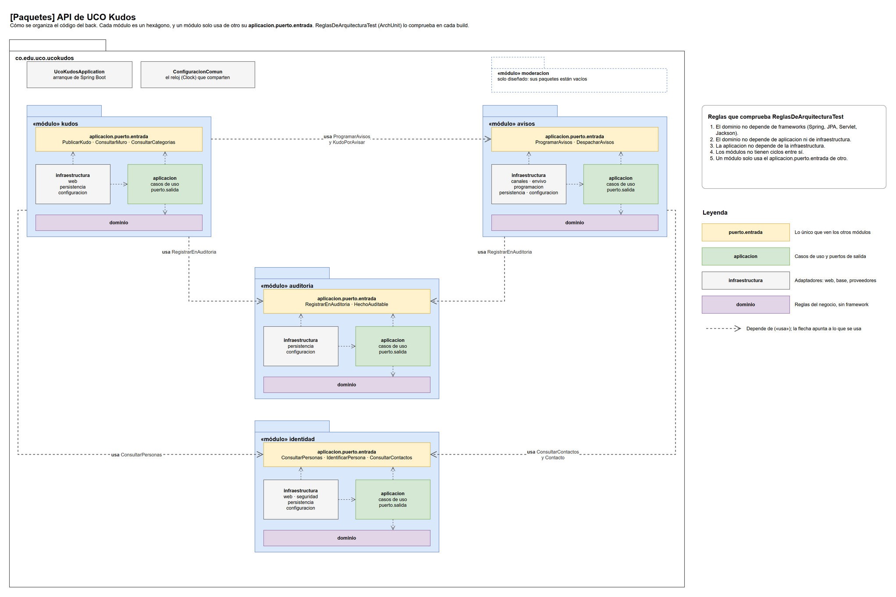
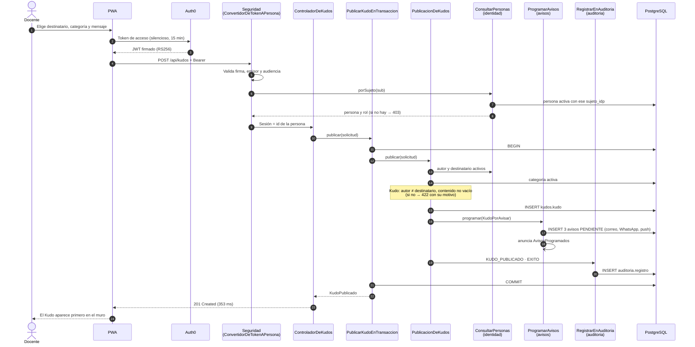
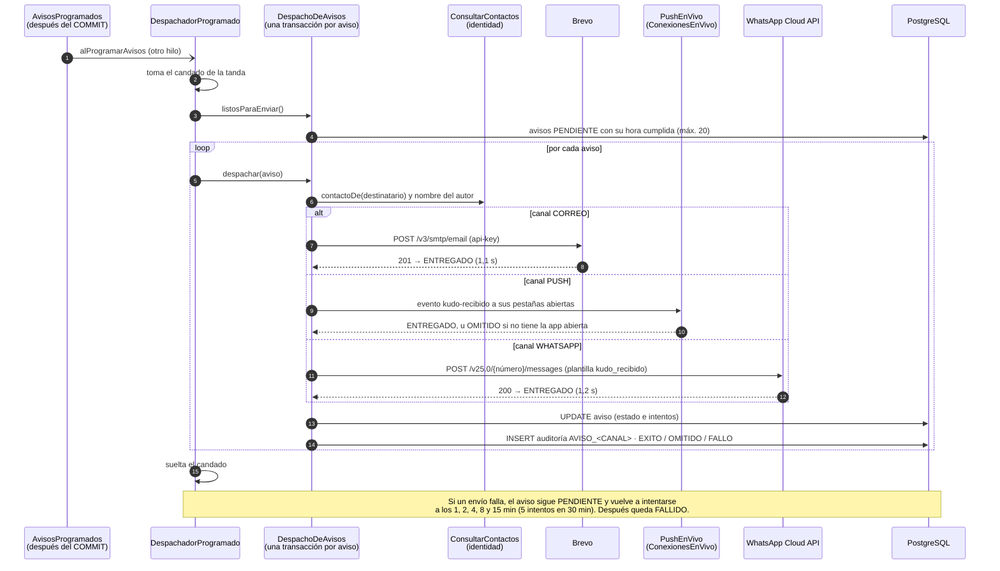
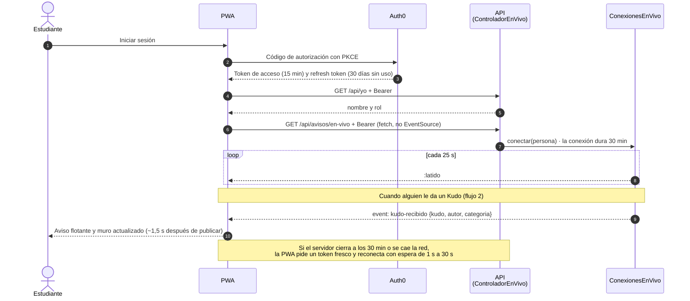

# UCO Kudos — Diseño detallado del back

> **Borrador:** preparado con IA a partir del código del back. Revísalo y borra esta nota cuando el
> documento sea tuyo.

**v0.2 · 15-nov-2026 · Jerónimo Montoya Londoño**

> Cómo está organizado por dentro el código de la API. Complementa el nivel 3 del
> [modelo C4](C4.md), que muestra los componentes.
>
> **Los diagramas están en draw.io:** [`imagenes/UCO-Kudos-diseno.drawio`](imagenes/UCO-Kudos-diseno.drawio).
> Los PNG de este documento se exportan de ese archivo.

## Paquetes del back

El código vive en `co.edu.uco.ucokudos` y se divide en cinco módulos, uno por cada hexágono de
`ADR-002`: `kudos`, `avisos`, `identidad`, `auditoria` y `moderacion`. Hoy `moderacion` solo está
diseñado, y sus paquetes están vacíos.

**Dentro de cada módulo** hay cuatro partes:

| Paquete | Qué guarda | De qué depende |
|---|---|---|
| `aplicacion.puerto.entrada` | Los contratos que usan los controladores y los otros módulos | Del dominio, si hace falta |
| `aplicacion` | Los casos de uso y los puertos de salida (por ejemplo, los repositorios) | Del dominio |
| `infraestructura` | Los adaptadores: web, persistencia, configuración y, según el módulo, seguridad, canales, canal en vivo o tareas programadas | De la aplicación y de sus puertos |
| `dominio` | Las reglas del negocio | De nada: ni de Spring ni de la base |

**Entre módulos** solo se usa el `aplicacion.puerto.entrada` del otro:

| Módulo | Usa de otro módulo |
|---|---|
| `kudos` | `ProgramarAvisos` y `KudoPorAvisar` de `avisos`; `ConsultarPersonas` de `identidad`; `RegistrarEnAuditoria` de `auditoria` |
| `avisos` | `ConsultarContactos` y `Contacto` de `identidad`; `RegistrarEnAuditoria` de `auditoria` |
| `identidad` | Nada |
| `auditoria` | Nada |

Así no hay ciclos entre módulos, y cada uno se puede probar con dobles de los puertos de los demás.

**Cómo se vigila:** `ReglasDeArquitecturaTest` (ArchUnit) corre en cada build de la CI y la detiene si
se rompe una de estas reglas:
1. El dominio no depende de frameworks (Spring, JPA, Servlet, Jackson).
2. El dominio no depende de `aplicacion` ni de `infraestructura`.
3. La `aplicacion` no depende de la `infraestructura`.
4. Los módulos no tienen ciclos entre sí.
5. Un módulo solo usa el `aplicacion.puerto.entrada` de otro.

## Diagramas de secuencia

Los tres flujos principales, tal como quedaron en producción el 15-nov-2026 (back `10ebe87`, front
`17246be`). Están en Mermaid, que GitHub dibuja directamente desde este Markdown. Los tiempos son los
de la traza real de Application Insights
(`docs/evidencias/observabilidad/observabilidad-transaccion.webp`).

### 1 · Publicar un Kudo (el flujo obligatorio)

Todo lo que queda guardado (el Kudo, sus tres avisos pendientes y la auditoría) va en **una sola
transacción** (`ADR-003`, `ADR-008`). La respuesta no espera a ningún canal: en producción tardó
353 ms.

Si cualquier paso falla antes del `COMMIT`, no queda nada: ni el Kudo, ni sus avisos, ni su
auditoría (`PublicacionAtomicaIT`).

### 2 · Despachar los avisos (correo, push y WhatsApp)

Apenas se confirma la transacción, el despachador atiende el anuncio en otro hilo. La vuelta periódica
de cada 5 s hace lo mismo para los reintentos. Un candado deja correr una sola tanda a la vez.

### 3 · Iniciar sesión y escuchar los avisos en vivo

## Patrones de diseño

Solo los que resuelven un problema real del proyecto. Para cada uno: dónde está, qué problema resuelve
y qué se gana.

| Patrón | Dónde está | Problema que resuelve | Beneficio obtenido |
|---|---|---|---|
| **Puertos y adaptadores** (arquitectura hexagonal) | Cada módulo: `aplicacion.puerto.entrada`, puertos de salida en `aplicacion` y adaptadores en `infraestructura` (`ADR-002`) | Los casos de uso no deben depender de Spring, de la base ni de los proveedores | Los casos de uso se prueban sin infraestructura, y cambiar de base o de proveedor no toca el negocio. ArchUnit lo vigila |
| **Strategy** | `CanalDeAviso`, con `CorreoPorBrevo`, `WhatsAppPorMeta` y `PushEnVivo` | Cada canal se envía distinto, y el despachador no debe tener un `switch` por canal | Agregar un canal es agregar una clase (`D-38`). Si un canal no tiene adaptador, la API no arranca |
| **Adapter** | `CorreoPorBrevo`, `WhatsAppPorMeta`, los `Repositorio…Jdbc` y `ConvertidorDeTokenAPersona` | Las API de Brevo y Meta, la base y el token de Auth0 hablan su propio idioma | El resto del código habla en términos de UCO Kudos (`MensajeDeAviso`, `Persona`, `Kudo`). Cambiar Brevo por otro proveedor es reemplazar un adaptador (plan B de `ADR-019`) |
| **Decorator** | `PublicarKudoEnTransaccion`, `DespacharAvisosEnTransaccion` y `ProgramarAvisosConDespachoInmediato` | La transacción y el despacho inmediato son transversales, y los casos de uso no deben depender de Spring | Los casos de uso quedan puros y se prueban sin transacción; la transacción y el anuncio se agregan por fuera |
| **Transactional Outbox** | La tabla `avisos.aviso` y `DespachadorProgramado` (`ADR-003`) | Publicar no puede perder un aviso ni depender de que los proveedores respondan | Ningún Kudo pierde su aviso (`ESC-04`). Los fallos se reintentan solos y todo termina en un estado final (`ESC-05`, `ESC-08`) |
| **Observer** (eventos de aplicación) | El evento `AvisosProgramados` y `@TransactionalEventListener` en el despachador | Despachar apenas se confirma la publicación, sin que `kudos` conozca al despachador | El push llega en ~1,5 s (`ESC-14`). Si la transacción se revierte, el evento se descarta |
| **Repository** | `RepositorioDeKudos`, `RepositorioDeAvisos`, `RepositorioDePersonas` y sus versiones `…Jdbc` | El dominio no debe saber de SQL | Las pruebas usan dobles en memoria (`AvisosEnMemoria`, `PersonasEnMemoria`); producción usa Spring Data JDBC |
| **Value Object** | `KudoId`, `IdPersona`, `IdCategoria`, `Contenido` | Un UUID o un texto sueltos no dicen qué son ni validan nada | Un Kudo no puede existir con contenido vacío ni con autor igual al destinatario (`KudoInvalido`) |
| **DTO** | Los `record` de `puerto.entrada`: `SolicitudDePublicacion`, `KudoPublicado`, `KudoDelMuro`, `PersonaActiva`, `Contacto` | Las entidades del dominio no deben salir por la API ni cruzar módulos | La API y los otros módulos ven solo lo necesario. Por ejemplo, el muro no expone correos ni celulares |
| **State** (máquina de estados del aviso) | `Aviso` y `EstadoDelAviso`: PENDIENTE → ENTREGADO, OMITIDO o FALLIDO | Las reglas de reintento no deben quedar repartidas en el despachador | Una sola clase decide cuándo reintentar y cuándo rendirse (`AvisoTest`) |
| **Composition Root** | Las clases `Configuracion…` de cada módulo | Los casos de uso no deben crear sus dependencias | Todo el cableado está en un solo lugar por módulo, y los casos de uso reciben todo por constructor |

**Lo que no se usó, a propósito:**
- Un **broker de mensajes**: el outbox en la misma base basta con una sola instancia (`ADR-003`, `ADR-011`).
- **JPA**: se usó Spring Data JDBC, sin carga perezosa ni caché de sesión (`ADR-017`).
- Un **Service Locator**: todas las dependencias entran por constructor.
